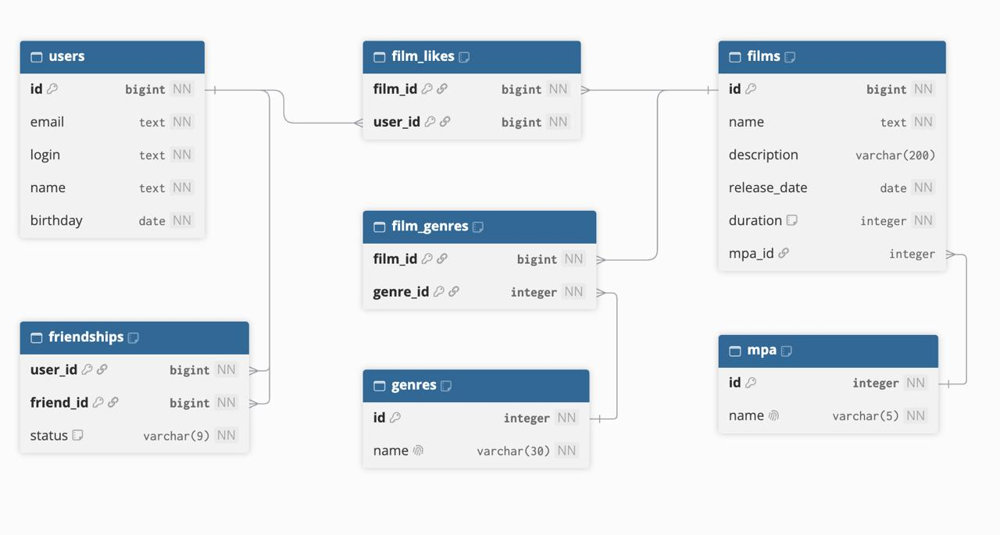

# Filmorate

## Схема базы данных



[Создание таблиц](src/main/resources/schema.sql) ·
[Начальные данные](src/main/resources/data.sql)

| Таблица | Назначение | Первичный ключ |
| --- | --- | --- |
| `users` | Пользователи | `id` |
| `films` | Фильмы | `id` |
| `mpa` | Справочник возрастных рейтингов | `id` |
| `genres` | Справочник жанров | `id` |
| `film_genres` | Жанры фильмов | `(film_id, genre_id)` |
| `film_likes` | Лайки пользователей | `(film_id, user_id)` |
| `friendships` | Связи дружбы и их статусы | `(user_id, friend_id)` |

### Связи и ограничения

- У фильма может быть несколько жанров. Связь с `genres` проходит через `film_genres`.
- Рейтинг MPA у фильма один или не указан. Поле `films.mpa_id` ссылается на `mpa.id`.
- Пользователь может поставить фильму один лайк. Повтор исключает ключ `(film_id, user_id)`.
- Заявка в друзья создаёт связь `A → B` со статусом `PENDING`. После встречного добавления
  существуют две связи — `A → B` и `B → A`, обе со статусом `CONFIRMED`.
  Дружба с собой запрещена. Удаление убирает только исходящую связь;
  оставшаяся встречная связь получает статус `PENDING`.
- При удалении фильма каскадно удаляются его лайки и связи с жанрами.
  При удалении пользователя — его лайки и связи дружбы.

## Примеры SQL-запросов

### Все пользователи

```sql
SELECT id, email, login, name, birthday
FROM users
ORDER BY id;
```

### Все фильмы с рейтингом MPA

```sql
SELECT f.id, f.name, f.description, f.release_date, f.duration,
       m.id AS mpa_id, m.name AS mpa_name
FROM films AS f
LEFT JOIN mpa AS m ON m.id = f.mpa_id
ORDER BY f.id;
```

### Жанры фильма

```sql
SELECT g.id, g.name
FROM film_genres AS fg
JOIN genres AS g ON g.id = fg.genre_id
WHERE fg.film_id = ?
ORDER BY g.id;
```

### Топ N популярных фильмов

```sql
SELECT f.id, f.name, f.description, f.release_date, f.duration, f.mpa_id,
       COUNT(fl.user_id) AS likes_count
FROM films AS f
LEFT JOIN film_likes AS fl ON fl.film_id = f.id
GROUP BY f.id, f.name, f.description, f.release_date, f.duration, f.mpa_id
ORDER BY likes_count DESC, f.id ASC
LIMIT ?;
```

### Друзья пользователя

```sql
SELECT u.id, u.email, u.login, u.name, u.birthday
FROM friendships AS fr
JOIN users AS u ON u.id = fr.friend_id
WHERE fr.user_id = ?
ORDER BY u.id;
```

### Общие друзья

```sql
SELECT u.id, u.email, u.login, u.name, u.birthday
FROM friendships AS f1
JOIN friendships AS f2 ON f2.friend_id = f1.friend_id
JOIN users AS u ON u.id = f1.friend_id
WHERE f1.user_id = ? AND f2.user_id = ?
ORDER BY u.id;
```

> **Примечание о MPA.** Фильм можно добавить, даже если его возрастной рейтинг пока неизвестен.
> В этом случае `mpa` хранится как `null`, а рейтинг можно указать позже.
> Это позволяет не подменять отсутствие информации рейтингом G, который означает отсутствие возрастных ограничений.
> Если рейтинг передан, его ID должен существовать в справочнике.
